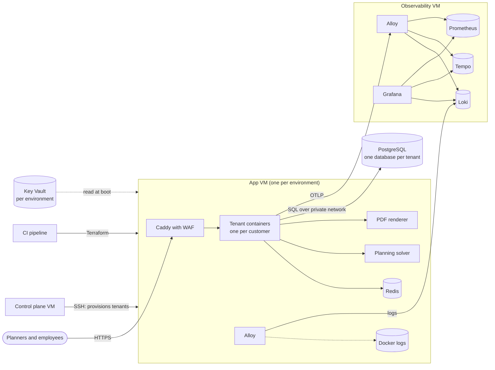

# Architecture: how Acme Planner is hosted today

This describes the setup as it is in this pack. It states facts and does not judge them. Where a fact is in a file, the file is named, so you can check it.

## Overview

The same diagram as an image, if your editor does not render Mermaid: [`architecture.png`](architecture.png).

Each environment has its own network, VM, database server and Key Vault. Apps do not talk to each other. The observability VM and the control plane VM are shared.

The delivery/CI arrow is product context outside this assessment. This pack supplies local read-only infrastructure checks, not deployment workflows or apply/destroy commands.

## Environments

| Environment | Purpose | Network (VNet) | VM size | Docker disk | PostgreSQL |
| --- | --- | --- | --- | --- | --- |
| `control` | Control plane: provisions tenants, runs the admin UI | 10.0.0.0/24 | Standard_B2s | 256 GB | Not part of this pack |
| `observability` | Logs, traces, metrics, Grafana | 10.0.10.0/24 | Standard_B2ms, plus 128 GB logs disk | 256 GB | None |
| `staging` | Release candidates and tenant tests | 10.0.1.0/24 | Standard_D2s_v5 | 512 GB | General Purpose D2s v3, 128 GB, no high availability, 7 days of backups |
| `production` | Customer tenants | 10.0.4.0/24 | Standard_D2s_v5 | 512 GB | General Purpose D2s v3, 128 GB, no high availability, 7 days of backups |

Terraform sources: `infra/environments/<name>/`. Each environment has its own state file. Values for each environment are in its `terraform.tfvars`.

## Network

- Each environment's VNet is peered with the observability VNet. The control VNet is peered with every app VNet, because the control plane reaches app VMs over SSH.
- App VNets are not peered with each other.
- PostgreSQL servers have no public endpoint. They are reached through a delegated subnet and a private DNS zone.
- Network security groups allow inbound traffic as follows:

| VM | Internet | Virtual network or peered VNets |
| --- | --- | --- |
| App | 80, 443, 22 | 22 (SSH from the control plane) |
| Control | 80, 443, 22 | none |
| Observability | 443, 80, 22 | 4317, 4318 (OTLP) and 3100 (Loki push) from 10.0.0.0/16 |

- Public DNS: a wildcard A record points at each app VM, for example `*.staging.planner.example`. Each tenant is a name below it. Grafana and the control plane have their own A records.

## App VM runtime

Compose file: `runtime/app/compose.yml`, written to `/opt/acme/compose.yml` on the VM.

| Service | Role | Published on the host |
| --- | --- | --- |
| `caddy` | TLS termination, WAF, one site file per tenant | 80, 443 |
| `redis` | Shared cache, sessions and key prefix per tenant | 6379 |
| `chrome` | Headless browser for PDF output | 3333 |
| `solver` | Planning solver (JVM) | 8090 |
| `alloy` | Ships container logs of the services above to Loki | none |

Tenant containers are not in the compose file. The control plane starts them with `docker run`, using `--restart=always` and the `acme-app` network. Each tenant gets a Caddy site file in `/etc/caddy/sites/<tenant>.caddy` that proxies to its container on port 3000. The provisioner is in `services/tenant-provisioner/src/provision-tenant.ts`.

## Tenant model

- One container per tenant per environment.
- One database per tenant on the environment's PostgreSQL server.
- One Redis instance per app VM, shared by its tenants, with a key prefix per tenant.
- Each tenant has its own hostname, for example `<tenant>.planner.example`.

## Identities and secrets

- Each environment has a Key Vault with role-based access. Secrets include the registry login, the DNS credentials for Caddy, the Redis password and the database admin password.
- A VM reads the secrets it needs at first boot with its managed identity (`infra/modules/vm/cloud-init/`). Secrets are not in the cloud-init file.
- Local infrastructure checks use mock providers and fixture inputs, not Azure authentication or remote state. The existing `github_actions_principal_id` input names a legacy deployment identity in the infrastructure model; the local tests supply a dummy value.
- The control plane VM has its own managed identity. Its grants are set in the Terraform files:

| Scope | Role | Defined in |
| --- | --- | --- |
| Container registry | Contributor | `infra/environments/control/main.tf` |
| Public DNS zone | DNS Zone Contributor | `infra/environments/control/main.tf` |
| Each app Key Vault | Key Vault Secrets Officer | `infra/environments/{staging,production}/main.tf` |
| Each app resource group | Reader | same |
| Each app PostgreSQL server | Contributor | same |

- Each VM's managed identity has Key Vault Secrets Officer on its own vault, so the VM can write the SSH host fingerprint on first boot (`infra/modules/vm/main.tf`).

## Delivery

- **Infrastructure checks:** `npm run infra.plan` displays a mocked plan for staging; `npm run infra.verify` validates and runs mock-provider plan tests for all four environments. Both run locally without credentials or an Azure backend and support environment selection. They do not detect live drift. Apply and destroy are outside this pack. See `docs/local-infrastructure.md`.
- **Tenants and application:** images are built and pushed to the registry. The control plane deploys tenants over SSH (TypeScript, `services/tenant-provisioner/`).
- **Runtime files on VMs:** `runtime/` is copied to the VMs by a deploy workflow, which is not part of this pack. Cloud-init runs once, at first boot.
- **OS patching:** Azure guest patching is enabled on all VMs. Automatic reboots are allowed (`infra/modules/vm/variables.tf`).

## Observability today

- The app and the tenants send traces, metrics and logs with OpenTelemetry (`services/demo-api/src/otel.ts` is the stand-in for the real telemetry code).
- Alloy on the observability VM receives OTLP and forwards traces to Tempo, metrics to Prometheus and logs to Loki.
- Alloy on each app VM ships the container logs of the base services to Loki.
- Grafana reads Loki, Tempo and Prometheus. Its data sources are provisioned from `runtime/observability/grafana/provisioning/`.
- Retention: Prometheus 30 days (`runtime/observability/compose.yml`), Tempo 7 days (`runtime/observability/tempo/tempo.yaml`). Loki: see `runtime/observability/loki/local-config.yaml`.

What is not in place today: alert rules, notification channels, checks from outside the network, database and Redis metrics, service level objectives, a status page.

## Operations today

Incidents are usually found by customers or by support. There is no on-call rota and no paging tool.

## Where things are in this pack

| Topic | Path |
| --- | --- |
| Terraform modules | `infra/modules/` |
| Terraform environments | `infra/environments/` |
| VM bootstrap and boot-time scripts | `infra/modules/vm/cloud-init/`, `infra/modules/vm/scripts/` |
| Compose files and configs | `runtime/` |
| Tenant provisioner (excerpt) | `services/tenant-provisioner/src/provision-tenant.ts` |
| Telemetry bootstrap and test service | `services/demo-api/src/` |
| Local infrastructure checks | `scripts/infra.mjs`, `scripts/lib/infra.mjs`, `docs/local-infrastructure.md` |
